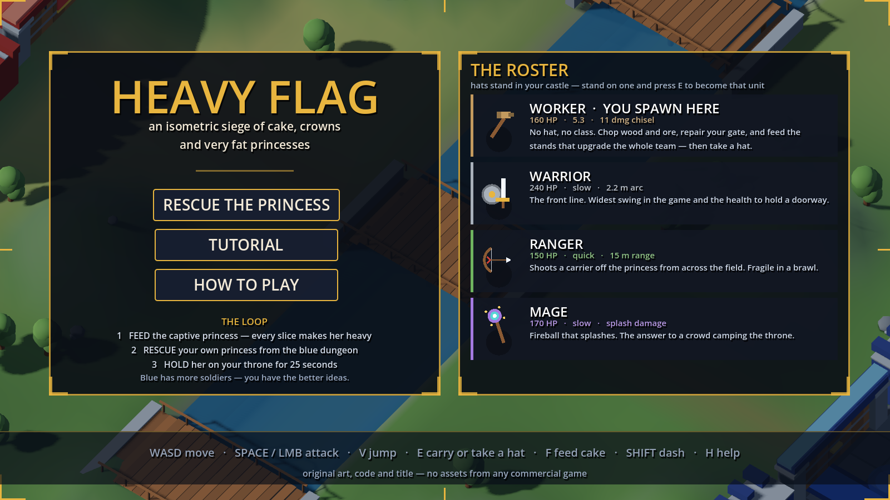
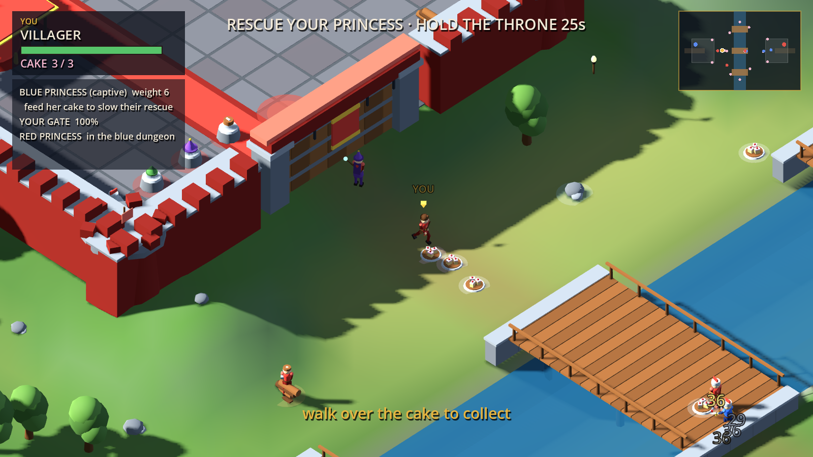

# Heavy Flag

An isometric 3D castle-siege capture-the-princess game for Godot 4.7.
Two castles, two kidnapped princesses, and a cake economy that decides how hard
each one is to carry home.




## Run it

```bash
# editor / native
godot --path ~/Documents/GodotProjects/heavy-flag

# web build (already exported in build/web)
./build.sh
python3 scripts/serve-web-build.py build/web --port 8090
# then open the port it prints
```

Menu: **Enter** starts a siege, **T** starts the tutorial (or click).

Controls: **WASD** move · **SPACE / LMB** attack · **SHIFT** dash ·
**E** carry / take hat · **F** feed cake · **Q** drop princess ·
**scroll** zoom · **ESC** pause · **H** help · **M** mute

## The menu teaches the game

The main menu is two cards: the loop (feed → rescue → hold) on the left, and a
roster of all four units on the right — pictogram, health, speed, range and what
each one is actually for — so you know what a hat does before you put it on.

## The loop

Your princess is locked in the enemy dungeon and theirs is locked in yours.

The field is 132 × 88 m: a river splits the map, three bridges are the only
crossings, and castles sit on plateaus above the surrounding hills. Castle walls
are 4.4 m high with a walkway on top — climb the inner stairs and shoot down
from the parapet.

1. **Feed** the captive princess in your dungeon. Every cake slice makes her
   heavier, and a heavy princess is slow to steal back — that is your wall.
2. **Rescue** your own princess from the enemy dungeon (E beside her).
3. **Hold** her on your throne for 25 seconds while the enemy team tries to
   kidnap her back.

Weight is speed: weight 6 is half speed, weight 10 is a statue, and allied
soldiers walking with you each add carrying speed.

Hats are classes: Warrior (sword), Ranger (bow), Mage (fireball), Villager
(fastest, and the slap makes enemies drop what they carry), and Worker (gathers
wood and ore, repairs your gate, and hits like a chisel).

The castle gate is a door with 700 HP — break it down to get in, and put a
worker on it to build it back up (never while it is being hit). The cage inside is locked: the key hangs from
a hook near that castle's gate, so a rescue is gate → key → cage → carry.

## Where things live

| path | what |
|---|---|
| `scripts/game.gd` | match state, AI, cake/weight economy, win-lose |
| `scripts/terrain.gd` | height field, river, bridges, terrain mesh, walkability |
| `scripts/build.gd` | castles, props and every character, generated from primitives |
| `scripts/unit.gd` | movement, combat, carrying |
| `scripts/princess.gd` | weight and carry state |
| `scripts/ui.gd` | menu, HUD, minimap, tutorial, cards |
| `docs/DESIGN.md` | mechanics, tuning knobs, test harnesses |
| `docs/LICENSES.md` | original-assets statement |

## Verified

- `godot --headless --path . -- --simtest=240` runs four minutes of match in
  about two seconds and prints the hold state; matches resolve (win at ~200 s
  with contested holds).
- `--movetest` proves isometric movement and both axes; `--keytest` proves the
  runtime input map; `--shots` renders offscreen frames.
- Web export boots in a browser, renders, starts a match from the menu, and
  walks the player with WASD. A fresh browser tab swallows the very first click
  while the canvas takes focus — press Enter, or click twice.

Everything is original: generated geometry, flat materials, synthesised
tones, original title. No assets from any commercial game.

## Online

Live at **https://capturetheprincess.723studios.com** with the room relay at
**https://capturetheprincess-api.723studios.com**.

- Pick **RED** or **BLUE** on the menu to join a room; the server balances teams
  first and honours the request second.
- Rooms hold **100 players** at a **20 Hz** snapshot rate; the wire is compact
  JSON arrays (a 100-player snapshot is ~4 KB), and the client lerps peers between
  snapshots instead of predicting them.
- The client sends its own state at 15 Hz, which is what makes this cheap: the
  server owns identity, teams and the clock, the client owns its own movement.
- **Solo is untouched.** Nothing in the net layer runs unless you press a side
  button, which is why the whole solo test suite still passes unchanged.

Load test (100 clients, one room, 12 s):

```
node soak.js --clients 100 --seconds 12
snapshots: 19.9 Hz avg / 19.8 worst · gap p95 51 ms · 63 KB/s per client · 0 errors
```

## The map

176 × 116 m, castles at |x| = 56, three bridges. Every castle also has a second
way in: a rocky ramp outside its side wall climbs above the battlements — walk up
and **jump (V)** down into the courtyard instead of battering the gate.

## The castle

Three levels: the courtyard, a raised keep in the middle (three steps up, a gold
balustrade, and the shrine that holds the key), and the wall walk on top of
3.6 m-thick walls — wide enough for archers to work. Respawns scatter across your
own half of the map rather than always dropping you at the castle door.

## Camera and outlines

`R` turns the camera a quarter turn at a time, and movement follows the view.
Any unit a wall or hill hides from you is drawn as an outline through the
structure — **yellow for your side, red for theirs** — so you can read a fight
you cannot see.

## You start hatless

Everyone spawns — and respawns — as a **worker** with no class hat. Three stands
in each castle hand out Warrior, Ranger and Mage; you have to walk to one and
press E. Die and your hat drops where you fell: any hatless worker can scoop it
up, so a corpse is worth looting.

That makes the worker the opening move rather than a chore — chop wood and ore,
deliver 3 + 3 to a stand to upgrade that class for the whole team (+22 % damage),
and put the door back up when it gets smashed. Then go take a hat.

## Characters

Every model is built from primitives at runtime — nothing is imported. Units are
hinged humanoids (hip/knee/shoulder/elbow), with faces, class headgear, and a
weapon in the hand that swings with the arm.

## Roles are multipliers

Every class gives the team something a lone player never gets — and none of it
is required:

- **Worker** — 3 wood + 3 ore at a class stand upgrades that class for the whole
  team (+22 % damage), and only workers repair the gate.
- **Ranger / Mage** — +35 % damage shooting down from a wall walk.
- **Warrior** — allies within 5 m take 18 % less damage.
- **Villager** — fastest, runs cake at full speed, slap drops enemy cargo.

Skip all of it and the game still plays; you just fight a team that uses it at a
disadvantage. If both sides dig in, sudden death at 300 s drops the gates and
pops the cages so the match cannot stalemate.
